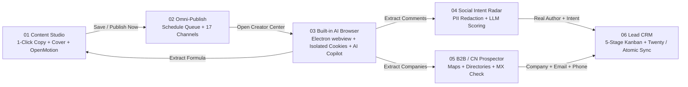

<div align="center">
  <h1>BiaoMai Lingshu (标脉灵枢)</h1>
  <p><strong>Open-Source, Zero-Docker, Global AI Lead-Generation & Outbound Growth Workbench</strong></p>
  <p>
    <a href="https://biao5fen.com"></a>
    <a href="./LICENSE"></a>
    <a href="./README.zh-CN.md"></a>
    <a href="./docs/en/USER_MANUAL.md"></a>
  </p>
</div>

---

**BiaoMai Lingshu (标脉灵枢)** is a local-first, Apache-2.0 open-source desktop workbench engineered for cross-border teams, B2B exporters, SaaS builders, and enterprise bidding/local service teams. Built on a hot-pluggable micro-kernel architecture (powered by the open-source AionUi runtime), it unifies **1-Click AI Content Creation**, **Built-in AI Browser**, **17-Channel Isolated Publishing**, **Social Intent Radar**, **Global & China B2B Prospecting**, and **Kanban Lead CRM + Open-Source CRM Sync**—all running 100% locally with zero Docker setup and strict human-in-the-loop compliance.

---

## Key Capabilities

| Module | What It Does | Local-First & Compliance |
| :--- | :--- | :--- |
| **01. 1-Click Content Studio** | Enter one sentence → generate copy + CTA, brand cover visual / AI image, and **OpenMotion** HTML5/Motion.md animation in one click; tweak any part inline. | Works with any OpenAI-compatible LLM (DeepSeek, OpenAI, Qwen, Ollama); falls back gracefully with zero external lock-in. |
| **02. 17-Channel Omni-Publish** | Manage isolated Cookie containers across 9 China + 8 Global channels (RedNote, Douyin, Channels, Zhihu, Bilibili, TikTok, YouTube, LinkedIn, X, Instagram, etc.) with a top-pinned schedule queue. | 2-stage human-confirmed publishing: auto-copy & prefill in Built-in AI Browser → human clicks Publish → mark Published. |
| **03. Built-in AI Browser** | Embedded Electron `<webview>` browser with address bar, bookmarks, multi-account Cookie partitions, and a right-side **AI Browser Copilot**. | 1-click extract comments → Radar, extract competitor formula → Create, extract companies → Prospector, or prefill drafts. |
| **04. Social Intent Radar** | Capture live comments with real author nicknames, mandatory PII redaction (phone/email/WeChat/URL), S/A/B/C intent scoring, LLM semantic refinement, and reply prefill. | Strictly stops before clicking Send; includes 1-click sample comments for instant offline testing. |
| **05. Global & CN Prospector** | **China Mode**: bulk company website/phone/email lookup + Amap/Baidu Maps. **Global Mode**: Google Maps, LinkedIn, Thomasnet, Europages, Alibaba + website enrichment + DNS MX check + multilingual cold email. | Zero-dependency local TLS/STARTTLS SMTP sender & IMAP reply detector; optional Crawl4AI sidecar support. |
| **06. Lead CRM + OSS Sync** | Built-in 5-stage Kanban board, table view, detail drawer, CSV export, ROI attribution, and 1-click REST sync to self-hosted **Twenty CRM** (`twentyhq/twenty`) or **Atomic CRM** (`marmelab/atomic-crm`). | Local JSON persistence (`biaomai-studio-db.json`); zero cloud lock-in. |
| **07. Micro-Kernel Plugins** | 11 built-in Apache-2.0 / MIT `.bmpack` extensions (including `plugin-oss-openmotion` with 1-click local OpenMotion Studio launcher & `plugin-oss-twenty-crm`), installable & uninstallable at runtime. | Automated license, i18n parity, and manifest integrity gates (`pnpm verify:all`). |

---

## End-to-End Architecture



---

## Quick Start

### Prerequisites
- Node.js `>= 20`, `pnpm >= 9`, `bun >= 1.1` (for the desktop runtime)

### Install & Launch Desktop App
```bash
git clone https://github.com/qiangenping/biaomai-lingshu.git
cd biaomai-lingshu
pnpm install
pnpm install:aionui-packs
pnpm dev:aionui
```

### Run Full Verification Suite (6 Gates)
```bash
pnpm verify:all
```

---

## Documentation
- [Complete User Manual (English)](./docs/en/USER_MANUAL.md) | [完整操作手册（简体中文）](./docs/zh-CN/USER_MANUAL.md)
- [Quick Start Guide](./docs/en/QUICKSTART.md) | [快速上手指南](./docs/zh-CN/QUICKSTART.md)
- [Architecture Overview](./docs/en/ARCHITECTURE.md) | [系统架构说明](./docs/zh-CN/ARCHITECTURE.md)
- [Plugin SDK Development Guide](./docs/en/PLUGIN_SDK_GUIDE.md) | [插件开发指南](./docs/zh-CN/PLUGIN_SDK_GUIDE.md)
- [Privacy & Compliance Policy](./PRIVACY_AND_COMPLIANCE.md)
- [Contributing Guide](./CONTRIBUTING.md) | [Security Policy](./SECURITY.md) | [Changelog](./CHANGELOG.md)

---

## Community & Support
- **Official Website**: [https://biao5fen.com](https://biao5fen.com)
- **GitHub Repository**: [https://github.com/qiangenping/biaomai-lingshu](https://github.com/qiangenping/biaomai-lingshu)
- **Issues & Feature Requests**: [GitHub Issues](https://github.com/qiangenping/biaomai-lingshu/issues)
- **Contact**: [genpingqian@gmail.com](mailto:genpingqian@gmail.com)

## License
Licensed under the [Apache License 2.0](./LICENSE). Third-party open-source attributions are documented in [THIRD_PARTY_NOTICES.md](./THIRD_PARTY_NOTICES.md).
