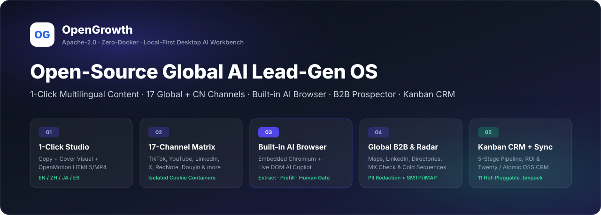
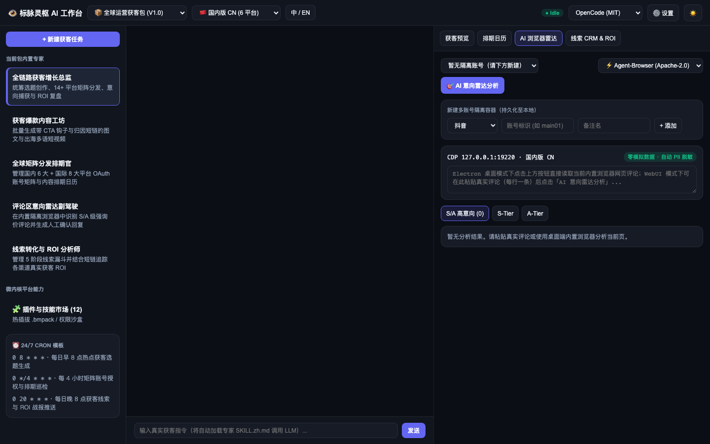
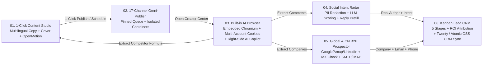

<div align="center">
  

  <br />
  <br />

  <h1>OpenGrowth (OpenGrowth)</h1>
  <p><strong>The Open-Source, Zero-Docker AI Growth OS for Global Lead Generation</strong></p>
  <p><em>Replace $500+/mo fragmented growth SaaS with one local-first desktop workbench: 1-Click Multilingual Content, 17-Channel Matrix, Built-in AI Browser, Social Intent Radar, Global B2B Prospector &amp; Kanban CRM.</em></p>

  <p>
    <a href="https://biao5fen.com"></a>
    <a href="./LICENSE"></a>
    <a href="https://github.com/qiangenping/opengrowth/releases/tag/v1.0.0"></a>
    <a href="https://github.com/qiangenping/opengrowth/actions/workflows/ci.yml"></a>
    <a href="https://github.com/qiangenping/opengrowth/stargazers"></a>
    <a href="./README.zh-CN.md"></a>
    <a href="./docs/en/USER_MANUAL.md"></a>
  </p>

  <br />
  

  <p>
    <a href="#why-opengrowth">Why OpenGrowth?</a> ·
    <a href="#core-modules-deep-dive">Core Modules</a> ·
    <a href="#17-global--china-channels">17 Channels</a> ·
    <a href="#micro-kernel-plugin-ecosystem-bmpack">Plugin Ecosystem</a> ·
    <a href="#quick-start-3-minutes">Quick Start</a> ·
    <a href="#roadmap">Roadmap</a> ·
    <a href="#documentation">Documentation</a>
  </p>
</div>

---

## Why OpenGrowth?

Global B2B teams, cross-border sellers, and indie SaaS founders typically stitch together **5–7 expensive cloud subscriptions**—a content scheduler, a video/motion editor, a social scraper, a B2B directory enricher, a cold-email sequencer, and a CRM—while risking account bans and leaking customer data to third-party clouds.

**OpenGrowth** unifies the entire **Inbound + Outbound Global Lead-Generation Loop** into a single **local-first, zero-Docker, Apache-2.0 desktop application** powered by a hot-pluggable micro-kernel:

| Capability | Typical Fragmented SaaS Stack ($500+/mo) | OpenGrowth (Apache-2.0 · $0) |
| :--- | :--- | :--- |
| **Multilingual Content & Motion** | Copy AI + Canva + CapCut / Remotion | **1-Click Studio**: Copy + Brand Cover + **OpenMotion** HTML5/MP4 in one button |
| **Multi-Channel Publishing** | Buffer / Hootsuite (API limits, no CN channels) | **17 Global + China Channels** via isolated Chromium Cookie containers |
| **Live Browser AI Operations** | Separate anti-detect browser + brittle scripts | **Built-in AI Browser** (`<webview>`) + live DOM AI Copilot side panel |
| **Social Buyer Intent Capture** | Manual scrolling or risky hidden scrapers | **Intent Radar**: Real author + PII redaction + LLM scoring + human-confirmed reply |
| **Global & China B2B Prospector** | Apollo / Clay + Instantly ($200+/mo) | **Maps + LinkedIn + Directories + Website MX Verification + Local SMTP/IMAP** |
| **CRM & Deal Pipeline** | HubSpot / Salesforce seat taxes | **Built-in 5-Stage Kanban CRM** + 1-click REST sync to **Twenty CRM** / **Atomic CRM** |
| **Data Privacy & Deployment** | Cloud-hosted credentials & Docker clusters | **100% Local Disk** (`biaomai-studio-db.json`), zero Docker, zero cloud lock-in |

---

## End-to-End Global Growth Loop



---

## Core Modules Deep-Dive

### 01. 1-Click Global Content Studio (`CreateStudioTab`)
- **Zero Friction**: Enter a one-sentence product pitch, choose your target channel & output language (`English`, `简体中文`, `日本語`, `Español`), and click **1-Click Generate All (Copy + Cover + Motion)**.
- **Tweak Only What You Want**: Edit headlines and body copy inline directly inside the live phone preview, switch between `Cover / Motion` views, or regenerate just the copy, cover, or **OpenMotion** animation individually.
- **Model Agnostic**: Automatically syncs your configured provider from **Settings → Models** (DeepSeek, OpenAI, Qwen, Claude-compatible proxies, or local Ollama) and falls back cleanly without breaking if no image key is set.
- **Draft History**: All saved creations remain accessible in **Recent Drafts** for instant reload and iteration.

### 02. 17-Channel Omni-Publish (`OmniPublishTab`)
- **Top-Pinned Schedule Queue**: Every saved draft appears immediately at the top with platform badge, status (`Scheduled` / `Published`), one-click copy, delete, and **Publish in AI Browser**.
- **2-Stage Human-Confirmed Publishing**: Clicking **Publish in AI Browser** opens the channel's creator portal inside an isolated Cookie partition and copies/prefills your draft—after you visually verify and publish, click **Mark Published** to record ROI attribution.
- **Multi-Account Containers**: Spin up unlimited isolated `persist:bm-acc-*` browser profiles per platform without cookie collisions.

### 03. Built-in AI Browser (`AiBrowserTab`)
- **Native Embedded Browser**: Powered by Electron `<webview>` with Back / Forward / Reload, editable URL bar, multi-account Cookie partition switcher, 8 built-in quick bookmarks (RedNote, Douyin, Zhihu, Amap, Baidu Map, Google Maps, LinkedIn), and optional Pop-Out window.
- **Right-Side AI Browser Copilot**:
  - **Extract Comments → Radar**: Reads visible DOM comments across RedNote, Douyin, Zhihu, YouTube, LinkedIn, and Bilibili with real author names and mandatory PII sanitization.
  - **Extract Formula → Create**: Summarizes any competitor post's hook and structure and sends it straight to **01 Content Studio** for original rewriting.
  - **Extract Companies → B2B**: Extracts company cards, websites, phones, and emails from Google Maps, Amap, Baidu Map, LinkedIn, and B2B directories.
  - **Prefill Active Page**: Copies and fills your latest post draft or reply directly into the active webpage's editor—always stopping before Submit.

### 04. Social Intent Radar (`IntentRadarTab`)
- **Live & Offline Modes**: Jump directly into the **Built-in AI Browser** to browse posts and capture comments, paste comments offline, or click **Load Sample Comments** to test the entire scoring pipeline in 1 second.
- **Mandatory Privacy Redaction**: Automatically redacts emails, phone numbers, WeChat IDs, and URLs before scoring or sending to an LLM (`GDPR / CCPA / PIPL` friendly).
- **LLM Semantic Scoring**: Ranks buyer intent (`S / A / B / C`), drafts high-converting replies, prefills browser reply boxes, and saves real author leads into **Lead CRM**.

### 05. Global & China B2B Prospector (`ProspectorOutboundTab`)
- **Global Outbound Mode**: Launch Google Maps, LinkedIn, Thomasnet, Europages, or Alibaba → extract companies → run **Website Contact Enrichment + DNS MX Verification** → draft multilingual 3-step cold email sequences (`Day 1 / 4 / 9`) → send via zero-dependency local TLS/STARTTLS **SMTP** and auto-stop sequences on **IMAP** reply detection. Optional **Crawl4AI** local sidecar bridge included.
- **China Domestic Mode**: Bulk company name lookup (official website, public phone, business email) + Amap & Baidu Maps merchant extraction.

### 06. Kanban Lead CRM + Open-Source CRM Sync (`LeadCrmTab`)
- **Commercial Built-in CRM**: 5-stage visual **Kanban Board** (`New` → `Engaged` → `Qualified` → `Opportunity` → `Won`), **Table View**, **Detail Drawer** (edit contact, company, email, phone, deal value, follow-up notes), **CSV Export**, and **Channel/Content ROI Attribution**.
- **Native Open-Source CRM Connector**: Sync qualified leads via REST API directly into self-hosted **[Twenty CRM](https://github.com/twentyhq/twenty)** (`/rest/people`), **[Atomic CRM](https://github.com/marmelab/atomic-crm)** (`/rest/v1/contacts`, MIT), or any custom REST Webhook (Feishu Bitable, EspoCRM, Krayin, HubSpot).

---

## 17 Global + China Channels

| Region | Supported Platforms | Aspect Ratio | Session Isolation |
| :--- | :--- | :---: | :---: |
| **Global (8)** | **TikTok**, **YouTube**, **LinkedIn**, **X (Twitter)**, **Instagram**, **Facebook**, **Threads**, **Pinterest** | `9:16` / `16:9` / `4:5` / `1:1` / `2:3` | Isolated `persist:` Cookie Partition |
| **China (9)** | **RedNote (小红书)**, **Douyin (抖音)**, **WeChat Channels (视频号)**, **Bilibili (B站)**, **Kuaishou (快手)**, **WeChat OA (公众号)**, **Weibo (微博)**, **Zhihu (知乎)**, **Baijiahao (百家号)** | `3:4` / `9:16` / `16:9` / `1:1` | Isolated `persist:` Cookie Partition |

---

## Micro-Kernel Plugin Ecosystem (`.bmpack`)

OpenGrowth ships with **11 hot-pluggable Apache-2.0 / MIT extensions** installed in `packs/`. You can install custom `.bmpack` directories or uninstall any plugin in **07 Packs Market**, and invoke every plugin skill via `/` in **New Conversation** (with automatic `zh-CN` / `en-US` localization):

| Plugin / Pack | Type | License | Capabilities |
| :--- | :--- | :---: | :--- |
| `pack-leadgen-ops` | Industry Pack | Apache-2.0 | End-to-end 17-channel content, radar, and CRM orchestration |
| `pack-global-b2b-outbound` | Industry Pack | Apache-2.0 | Global B2B directory prospecting, MX verification & multilingual cold outreach |
| `pack-crossborder-ecom` | Industry Pack | Apache-2.0 | Cross-border DTC & TikTok/IG/YouTube creator outreach copilot |
| `pack-tob-bidding` | Industry Pack | Apache-2.0 | Public tender intelligence & bid compliance analyst |
| `pack-template` | Starter Kit | Apache-2.0 | 5-minute template to author your own vertical `.bmpack` plugin |
| `plugin-oss-openmotion` | OSS Plugin | Apache-2.0 | Wraps `nexu-io/openmotion` with **1-click local full OpenMotion Studio launcher** |
| `plugin-oss-twenty-crm` | OSS Plugin | Apache-2.0 | Connects Twenty CRM (`twentyhq/twenty`) & Atomic CRM (`marmelab/atomic-crm`) |
| `plugin-oss-crawl4ai` | OSS Plugin | Apache-2.0 | Wraps `unclecode/crawl4ai` for directory & tender web extraction |
| `plugin-oss-gmaps-scraper` | OSS Plugin | MIT | Bulk Google Maps B2B merchant extraction |
| `plugin-oss-openoutreach` | OSS Plugin | Apache-2.0 | AI ICP fit scoring & personalized cold opener drafting |
| `plugin-oss-quickly-mailer` | OSS Plugin | MIT | Multi-inbox rotation & 3-step cold email sequence discipline |
| `plugin-oss-agentsdr` | OSS Plugin | MIT | Coordinated Email + LinkedIn + WhatsApp outreach workflow |

---

## Built for 6 Global Industry Playbooks

Switch industry presets anytime from the top bar:
1. **Global Manufacturing & Trade** — CNC parts, machinery, building materials targeting EU/US/ME buyers.
2. **Cross-Border E-Commerce & Creators** — DTC products & TikTok/YouTube/IG influencer seeding.
3. **Global B2B SaaS & Tech** — Multilingual thought leadership on LinkedIn/X/YouTube + outbound demos.
4. **Enterprise ToB & Public Tenders** — Bid risk compliance, tender monitoring, and enterprise contact discovery.
5. **Local Services & Retail** — Hyper-local RedNote/Douyin/Google Maps buyer capture.
6. **Custom Vertical** — Define your own market, pitch, and custom `.bmpack` plugins.

---

## Quick Start (3 Minutes)

### Prerequisites
- **Node.js** `>= 20`
- **pnpm** `>= 9`
- **Bun** `>= 1.1` (used by the desktop Electron runtime)

### 1. Clone, Install & Launch Desktop App
```bash
git clone https://github.com/qiangenping/opengrowth.git
cd opengrowth
pnpm setup
pnpm dev:aionui
```
> `pnpm setup` installs root workspace packages, `vendor/aionui` Electron runtime dependencies (via Bun), and syncs all 11 `.bmpack` plugins.

### 2. Configure Your Model (30 Seconds)
1. Open **Settings → Models** in the left sidebar and add any OpenAI-compatible provider (e.g., DeepSeek, OpenAI, Qwen, or local Ollama).
2. Switch to **Lead-Gen Studio → Create Studio** — your model is auto-synced! Enter a product pitch and click **1-Click Generate All**.

### 3. Run All 6 Automated Quality Gates
```bash
pnpm verify:all
```
Verifies: `verify:i18n` (symmetric `zh-CN`/`en-US` keys) → `verify:licenses` (Apache-2.0/MIT audit) → `verify:packs` (65 pack manifest files) → `tsc --noEmit` → `vitest run` (6 test suites, 17 tests) → `@biaomai/workbench` production build.

---

## Privacy, Compliance & Anti-Ban Design

- **Zero Cloud Lock-In**: API keys, SMTP/IMAP credentials, leads, posts, and browser sessions stay strictly on your local disk.
- **Human-in-the-Loop Gates**: Automated reply and post prefills highlight the input field and **always stop before clicking Send/Publish**, preventing spam and platform bans.
- **Mandatory PII Redaction**: Phone numbers, emails, WeChat IDs, and URLs are scrubbed from social comments before LLM processing.
- **Clean Licensing**: Core codebase and bundled packs are strictly **Apache-2.0 / MIT**; AGPL tools like Twenty CRM are integrated cleanly over external REST APIs without bundling copyleft code.

---

## Documentation

| Document | English | 简体中文 |
| :--- | :--- | :--- |
| **Complete User Manual** | [USER_MANUAL.md](./docs/en/USER_MANUAL.md) | [操作手册](./docs/zh-CN/USER_MANUAL.md) |
| **Quick Start Guide** | [QUICKSTART.md](./docs/en/QUICKSTART.md) | [快速上手](./docs/zh-CN/QUICKSTART.md) |
| **Architecture Overview** | [ARCHITECTURE.md](./docs/en/ARCHITECTURE.md) | [系统架构](./docs/zh-CN/ARCHITECTURE.md) |
| **Plugin SDK Guide** | [PLUGIN_SDK_GUIDE.md](./docs/en/PLUGIN_SDK_GUIDE.md) | [插件开发指南](./docs/zh-CN/PLUGIN_SDK_GUIDE.md) |
| **Deployment Guide** | [DEPLOYMENT.md](./docs/en/DEPLOYMENT.md) | [部署指南](./docs/zh-CN/DEPLOYMENT.md) |
| **Global Roadmap** | [ROADMAP.md](./ROADMAP.md) | [全球共建路线图](./ROADMAP.md) |
| **Governance & Security** | [CONTRIBUTING.md](./CONTRIBUTING.md) · [SECURITY.md](./SECURITY.md) · [PRIVACY_AND_COMPLIANCE.md](./PRIVACY_AND_COMPLIANCE.md) | [贡献指南](./CONTRIBUTING.zh-CN.md) · [更新日志](./CHANGELOG.md) |

---

## Roadmap

- [x] **1-Click Multilingual Content Studio** (Copy + Cover + OpenMotion HTML5/MP4)
- [x] **17 Global & China Channels** with isolated Chromium Cookie partitions (`persist:bm-acc-*`)
- [x] **Built-in AI Browser + Social Intent Radar** (PII redaction + LLM scoring + prefill)
- [x] **Global & China B2B Prospector** (Maps/LinkedIn + DNS MX + local SMTP/IMAP sequences)
- [x] **5-Stage Kanban Lead CRM** + REST sync to Twenty CRM & Atomic CRM
- [ ] **WhatsApp Business / Telegram / Threads** native outreach connectors ([#1](https://github.com/qiangenping/opengrowth/issues/1))
- [ ] **HubSpot / Salesforce / Pipedrive** bidirectional CRM sync ([#2](https://github.com/qiangenping/opengrowth/issues/2))
- [ ] **Multilingual UI Expansion** (`es`, `ja`, `de`, `ko`, `pt-BR`) ([#3](https://github.com/qiangenping/opengrowth/issues/3))

See the full roadmap in [ROADMAP.md](./ROADMAP.md).

---

## Build Global Customer Acquisition With Us (Contributors Wanted!)

We are building **OpenGrowth** as a truly global, community-driven open-source growth engine. Developers, growth engineers, designers, and marketers worldwide are warmly invited to join:

- **Explore the Roadmap**: See upcoming global channels, CRM connectors, and AI Browser tracks in [ROADMAP.md](./ROADMAP.md).
- **Claim a Starter Task**: Pick up a [`good first issue`](https://github.com/qiangenping/opengrowth/issues?q=is%3Aissue+is%3Aopen+label%3A%22good+first+issue%22) or [`help wanted`](https://github.com/qiangenping/opengrowth/issues?q=is%3Aissue+is%3Aopen+label%3A%22help+wanted%22) issue — add WhatsApp/Telegram/Threads, HubSpot/Salesforce CRM sync, new UI languages (`es`/`ja`/`de`/`ko`/`pt-BR`), or a `.bmpack` industry playbook.
- **15-Minute First PR**: Follow our step-by-step [CONTRIBUTING.md](./CONTRIBUTING.md) playbook (`pnpm verify:all` + `git commit -s`).
- **Join the Community**: Pitch ideas, showcase your growth workflows, or ask questions in [GitHub Discussions](https://github.com/qiangenping/opengrowth/discussions).

---

## Community & Support

- **Website**: [https://biao5fen.com](https://biao5fen.com)
- **GitHub**: [https://github.com/qiangenping/opengrowth](https://github.com/qiangenping/opengrowth)
- **Discussions**: [GitHub Discussions](https://github.com/qiangenping/opengrowth/discussions)
- **Issues & Proposals**: [GitHub Issues](https://github.com/qiangenping/opengrowth/issues)
- **Contact**: [genpingqian@gmail.com](mailto:genpingqian@gmail.com)

If OpenGrowth helps your global growth workflow, please consider giving us a **Star** on GitHub!

## License

Released under the [Apache License 2.0](./LICENSE). Third-party open-source notices are listed in [THIRD_PARTY_NOTICES.md](./THIRD_PARTY_NOTICES.md).
