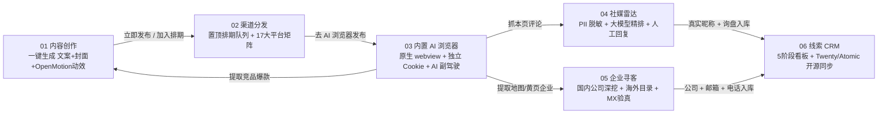

<div align="center">
  <h1>标脉灵枢（BiaoMai Lingshu）</h1>
  <p><strong>开源 · 免 Docker · 全行业全球 AI 获客与主动增长桌面工作台</strong></p>
  <p>
    <a href="https://biao5fen.com"></a>
    <a href="./LICENSE"></a>
    <a href="./README.md"></a>
    <a href="./docs/zh-CN/USER_MANUAL.md"></a>
  </p>
</div>

---

**标脉灵枢（BiaoMai Lingshu）** 是一款面向外贸制造、跨境电商、政企招投标、软件 SaaS 出海及本地生活团队的开源全链路 AI 获客桌面工作台。基于微内核热插拔架构（由开源 AionUi 运行时驱动），整合 **一键全套内容创作**、**内置 AI 浏览器**、**17 大社媒隔离矩阵分发**、**社媒意向雷达**、**全球与国内企业寻客** 以及 **5 阶段看板 CRM + Twenty/Atomic 开源 CRM 同步**——100% 本地运行、免 Docker 部署、坚持人机协同合规门禁。

---

## 核心功能矩阵

| 模块 | 核心能力 | 本地化与合规特性 |
| :--- | :--- | :--- |
| **01. 一键内容创作** | 输入一句话卖点 → **一键生成「高转化文案 + 品牌视觉封面 + OpenMotion 动效」**；支持右侧手机预览行内修改与单点重生成（换文案/换封面/换动效），附历史草稿回填。 | 自动同步系统「设置 → 模型」配置的任意 OpenAI 兼容大模型（DeepSeek/OpenAI/通义/Ollama），无 Key 也可本地兜底跑通。 |
| **02. 17 大渠道分发** | 覆盖国内 9 大 + 海外 8 大平台（小红书、抖音、视频号、B站、快手、公众号、微博、知乎、百家号、TikTok、YouTube、LinkedIn、X、Instagram 等），置顶排期队列 + 多账号隔离容器。 | 二段式合规发布：点击「去 AI 浏览器发布」自动复制并回填草稿 → 人工在平台发出 → 点击「标记已发布」计入 ROI。 |
| **03. 内置 AI 浏览器** | 原生 Electron `<webview>` 内嵌浏览器，含地址栏、前进/后退/刷新、8 大常用书签、独立 Cookie 分区切换与右侧 **AI 浏览器副驾驶**。 | 一键抓取本页评论送入社媒雷达、提取竞品爆款送入内容创作、提取地图/黄页企业送入企业寻客、一键回填草稿/回复。 |
| **04. 社媒意向雷达** | 支持多平台真实评论者昵称提取、强制 PII 隐私脱敏（手机号/微信号/邮箱/外链）、S/A/B/C 意向分级、大模型语义精排与回复草稿自动回填。 | 严格停在「发送」按钮前人工确认；内置「一键示例评论测试」零门槛体验。 |
| **05. 全球与国内寻客** | **国内模式**：批量公司名查官网/电话/邮箱 + 高德/百度地图；**海外模式**：Google Maps / LinkedIn / Thomasnet / Europages / Alibaba + 官网公开邮箱提取 + DNS MX 验真 + 多语种开发信。 | 零依赖 TLS/STARTTLS 本地发信与 IMAP 回信自动停发；可选接入本地 Crawl4AI 爬虫。 |
| **06. 线索 CRM 与开源同步** | 内置 5 阶段看板（Kanban）+ 列表视图 + 详情抽屉 + CSV 导出 + 内容 ROI 复盘；支持一键 REST 同步至自建 **Twenty CRM**（`twentyhq/twenty`）或 **Atomic CRM**（`marmelab/atomic-crm`）。 | 全量本地 JSON 持久化（`biaomai-studio-db.json`），零云端锁定。 |
| **07. 微内核行业插件** | 内置 11 个 Apache-2.0 / MIT 标准 `.bmpack` 插件（含 **OpenMotion 本地完整版 Studio 一键启停** 与 **Twenty CRM 连接器**），支持热插拔安装/卸载与新对话 `/` 全量调用。 | 内置 6 项自动化开源门禁校验（`pnpm verify:all`）。 |

---

## 端到端获客闭环架构



---

## 快速开始

### 环境要求
- Node.js `>= 20`、`pnpm >= 9`、`bun >= 1.1`

### 一键启动桌面工作台
```bash
git clone https://github.com/qiangenping/biaomai-lingshu.git
cd biaomai-lingshu
pnpm install
pnpm install:aionui-packs
pnpm dev:aionui
```

### 运行全量门禁校验（6 项）
```bash
pnpm verify:all
```

---

## 完整文档索引
- [完整操作手册（简体中文）](./docs/zh-CN/USER_MANUAL.md) | [Complete User Manual (EN)](./docs/en/USER_MANUAL.md)
- [快速上手指南](./docs/zh-CN/QUICKSTART.md) | [Quick Start (EN)](./docs/en/QUICKSTART.md)
- [系统架构说明](./docs/zh-CN/ARCHITECTURE.md) | [Architecture (EN)](./docs/en/ARCHITECTURE.md)
- [插件开发指南 (.bmpack)](./docs/zh-CN/PLUGIN_SDK_GUIDE.md) | [Plugin SDK Guide (EN)](./docs/en/PLUGIN_SDK_GUIDE.md)
- [隐私与合规声明](./PRIVACY_AND_COMPLIANCE.md)
- [贡献指南](./CONTRIBUTING.zh-CN.md) | [安全策略](./SECURITY.md) | [更新日志](./CHANGELOG.md)

---

## 官网与联系
- **官方网站**：[https://biao5fen.com](https://biao5fen.com)
- **GitHub 仓库**：[https://github.com/qiangenping/biaomai-lingshu](https://github.com/qiangenping/biaomai-lingshu)
- **问题反馈**：[GitHub Issues](https://github.com/qiangenping/biaomai-lingshu/issues)
- **联系作者**：[genpingqian@gmail.com](mailto:genpingqian@gmail.com)

## 开源协议
本项目基于 [Apache License 2.0](./LICENSE) 开源；第三方开源组件声明详见 [THIRD_PARTY_NOTICES.md](./THIRD_PARTY_NOTICES.md)。
