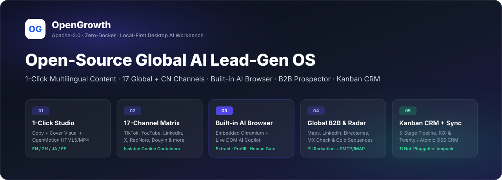
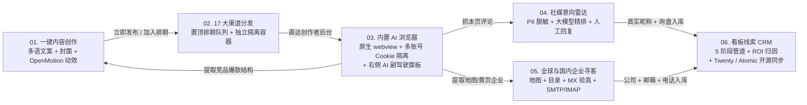

<div align="center">
  

  <br />
  <br />

  <h1>标脉灵枢（BiaoMai Lingshu）</h1>
  <p><strong>面向全球市场的开源、免 Docker 全链路 AI 获客工作台</strong></p>
  <p><em>用一套 100% 本地运行的桌面软件，替代每月 $500+ 的碎片化获客 SaaS：一键多语内容与动效创作 · 17 大全球/国内社媒矩阵 · 内置 AI 浏览器 · 社媒意向雷达 · 全球 B2B 寻客 · 看板 CRM 与开源同步。</em></p>

  <p>
    <a href="https://biao5fen.com"></a>
    <a href="./LICENSE"></a>
    <a href="https://github.com/qiangenping/biaomai-lingshu/releases/tag/v1.0.0"></a>
    <a href="./README.md"></a>
    <a href="./docs/zh-CN/USER_MANUAL.md"></a>
  </p>
</div>

---

## 为什么选择标脉灵枢？

出海企业、外贸工厂、跨境电商与 B2B 团队往往要同时购买 5~7 个昂贵的云端 SaaS（多平台排期工具 + 封面/动效剪辑 + 评论爬虫 + 客户邮箱挖掘 + 冷邮件发信机 + CRM），不仅每月支出超 $500，还面临账号关联封号与客户数据外泄风险。

**标脉灵枢** 将 **「内容引流（Inbound）+ 主动寻客（Outbound）+ 线索成交（CRM）」** 完整装进一个 **免 Docker、100% 本地优先、Apache-2.0 开源** 的微内核桌面工作台：

| 核心能力 | 传统碎片化云端 SaaS（$500+/月） | 标脉灵枢（Apache-2.0 · $0 开源） |
| :--- | :--- | :--- |
| **多语内容与动效创作** | 文案 AI + Canva + 剪映 / Remotion | **一键创作工坊**：1 次点击同时产出多语文案 + 品牌封面 + **OpenMotion** 动效 |
| **全球 + 国内多平台分发** | Buffer / Hootsuite（限接口、不支持国内） | **17 大全球与国内平台**，独立 Cookie 隔离容器直连 |
| **浏览器 AI 协同操作** | 独立指纹浏览器 + 易失效脚本 | **内置 AI 浏览器**（原生 `<webview>`）+ 右侧实时 DOM AI 副驾驶 |
| **社媒评论区高意向捕获** | 人工翻评论或违规后台爬虫 | **社媒意向雷达**：真实昵称 + 强制 PII 脱敏 + 大模型精排 + 人工确认回填 |
| **全球与国内企业寻客** | Apollo / Clay + Instantly（$200+/月） | **Google/高德/百度地图 + LinkedIn + 黄页 + MX 验真 + 本地 SMTP/IMAP** |
| **线索管道与 CRM 成交** | HubSpot / Salesforce 按席位收费 | **内置 5 阶段看板 CRM** + 一键同步 **Twenty CRM** / **Atomic CRM** |
| **数据主权与部署成本** | 密钥上云、Docker 集群维护重 | **100% 本机存储**，免 Docker，无云端绑定 |

---

## 全链路全球获客闭环



---

## 七大核心模块详解

1. **01. 一键全球内容创作**：输入一句话产品卖点，支持 `简体中文 / English / 日本語 / Español` 四语输出，一键同时产出标题正文 CTA + 平台封面视觉 + **OpenMotion** 动效预览；右侧手机预览支持行内直接编辑与「换文案 / 换封面 / 换动效」局部微调，自动保存历史草稿。
2. **02. 17 大全球 + 国内渠道分发**：涵盖 **海外 8 大**（TikTok、YouTube、LinkedIn、X、Instagram、Facebook、Threads、Pinterest）与 **国内 9 大**（小红书、抖音、视频号、B站、快手、公众号、微博、知乎、百家号），采用「去 AI 浏览器发布（自动复制/回填）→ 人工发布 → 标记已发布」二段式合规闭环。
3. **03. 内置 AI 浏览器**：内嵌原生 Electron `<webview>`，带地址栏、8 大快捷书签与多账号独立 Cookie 分区；右侧 **AI 副驾驶** 一键抓评论送雷达、提爆款送创作、抓地图/黄页企业送寻客、回填草稿与回复。
4. **04. 社媒意向雷达**：支持从内置 AI 浏览器实时抓评论、离线粘贴分析与一键示例评论体验；强制脱敏手机号/微信号/邮箱/外链，结合大模型进行 S/A/B/C 语义精排与回复草稿回填。
5. **05. 全球与国内企业寻客**：**海外模式**直连 Google Maps、LinkedIn、Thomasnet、Europages、Alibaba 并支持官网邮箱提取 + DNS MX 验真 + 3 轮多语开发信 + 本地 SMTP/IMAP 收发与回信停发；**国内模式**支持批量公司名深挖官网/电话/邮箱与高德/百度地图提取。
6. **06. 看板线索 CRM + 开源同步**：内置 5 阶段看板（Kanban）、表格列表、右侧详情抽屉、CSV 导出与内容 ROI 归因；支持一键通过 REST API 同步至自建 **Twenty CRM**（`twentyhq/twenty`）或 **Atomic CRM**（`marmelab/atomic-crm`）。
7. **07. 微内核行业插件生态（`.bmpack`）**：内置 11 个 Apache-2.0 / MIT 标准热插拔插件（含 **OpenMotion 本地完整版 Studio 一键启停**、**Twenty CRM 连接器**、**Crawl4AI**、**Google Maps Scraper** 等），支持本地安装/卸载及新对话 `/` 全量双语调用。

---

## 3 分钟快速开始

```bash
git clone https://github.com/qiangenping/biaomai-lingshu.git
cd biaomai-lingshu
pnpm install
pnpm install:aionui-packs
pnpm dev:aionui
```

1. 启动后在左下角 **「设置 → 模型」** 配置任意 OpenAI 兼容模型（DeepSeek / OpenAI / 通义千问 / Ollama 等），工作台会自动同步。
2. 运行全量 6 项开源门禁校验：`pnpm verify:all`。

---

## 完整文档索引
- [完整操作手册（简体中文）](./docs/zh-CN/USER_MANUAL.md) | [Complete User Manual (EN)](./docs/en/USER_MANUAL.md)
- [快速上手指南](./docs/zh-CN/QUICKSTART.md) | [系统架构说明](./docs/zh-CN/ARCHITECTURE.md) | [插件开发指南](./docs/zh-CN/PLUGIN_SDK_GUIDE.md) | [部署指南](./docs/zh-CN/DEPLOYMENT.md)
- [隐私与合规声明](./PRIVACY_AND_COMPLIANCE.md) | [全球共建路线图](./ROADMAP.md) | [贡献指南](./CONTRIBUTING.zh-CN.md) | [安全策略](./SECURITY.md) | [更新日志](./CHANGELOG.md)

## 邀请全球开发者一起共建

我们期望与全球开发者、出海增长团队和行业实战专家一起，把这套开源全球获客工作台做到极致：
- **查看路线图**：在 [ROADMAP.md](./ROADMAP.md) 查看 WhatsApp / Telegram / Threads 渠道扩展、HubSpot / Salesforce CRM 同步、多语言国际化（日/韩/西/德/葡等）与 `.bmpack` 行业剧本规划。
- **认领入门任务**：前往 [`good first issue`](https://github.com/qiangenping/biaomai-lingshu/issues?q=is%3Aissue+is%3Aopen+label%3A%22good+first+issue%22) 或 [`help wanted`](https://github.com/qiangenping/biaomai-lingshu/issues?q=is%3Aissue+is%3Aopen+label%3A%22help+wanted%22) 直接认领任务，按 [CONTRIBUTING.zh-CN.md](./CONTRIBUTING.zh-CN.md) 15 分钟提交你的第一个 PR。
- **社区讨论与提案**：在 [GitHub Discussions](https://github.com/qiangenping/biaomai-lingshu/discussions) 发起新渠道、新插件或行业实战讨论。

## 官网与社区
- **官方网站**：[https://biao5fen.com](https://biao5fen.com)
- **GitHub 仓库**：[https://github.com/qiangenping/biaomai-lingshu](https://github.com/qiangenping/biaomai-lingshu)
- **社区讨论区**：[GitHub Discussions](https://github.com/qiangenping/biaomai-lingshu/discussions)
- **问题反馈与提案**：[GitHub Issues](https://github.com/qiangenping/biaomai-lingshu/issues)
- **联系作者**：[genpingqian@gmail.com](mailto:genpingqian@gmail.com)

如果标脉灵枢对你的全球获客有帮助，欢迎在 GitHub 点一个 **Star**！本项目基于 [Apache License 2.0](./LICENSE) 开源。
